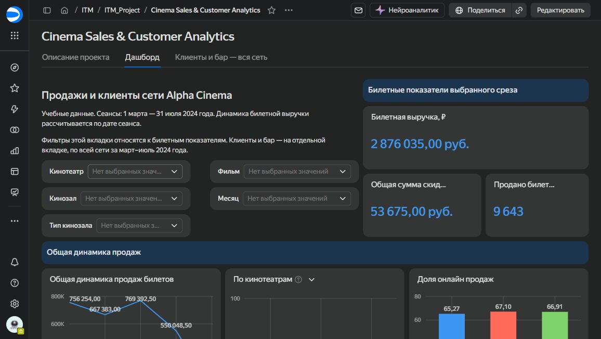

# Cinema Sales & Customer Analytics

Учебный анализ продаж сети Alpha Cinema: билетная выручка, использование вместимости, каналы продаж и клиентские группы. Данные охватывают сеансы **1 марта — 31 июля 2024 года**, три кинотеатра и девять залов.

**[Открыть интерактивный дашборд в DataLens](https://datalens.ru/5e5xahyokzwip-cinema-sales-customer-analytics?tab=L1)**

[Анализ в Python](notebooks/Project_v2.ipynb) · [SQL](sql/tickets_enriched.sql) · [Определения метрик](docs/METRICS.md) · [Дизайн A/B-теста](docs/AB_TEST_DESIGN.md)



## Задача и реализация

Проект отвечает на вопросы: как меняются продажи сети, какие кинотеатры эффективнее используют доступную вместимость, как различается загрузка по времени суток и какую выручку приносят клиентские группы.

- **SQL / ClickHouse:** объединение продаж с расписанием и справочниками, CTE, оконные функции, расчёт цены билета после скидки.
- **Python / pandas:** загрузка данных из ClickHouse, исследование и очистка данных, удаление дублей в продажах бара, подготовка сеансовой и клиентской витрин.
- **DataLens:** KPI, динамика, сравнение кинотеатров, заполняемость по времени суток, клиентские группы и фильтры билетных показателей. Бар и клиентские показатели за период относятся ко всей сети.
- **Эксперименты:** дизайн будущего A/B-теста рекомендаций утренних и дневных сеансов с рандомизацией, метриками и расчётом выборки. Эксперимент не проводился.

## Основные результаты

1. **В июле билетная выручка снизилась на 83% относительно мая:** с 769,4 до 133,0 тыс. ₽. Сеансов стало на 44% меньше, заполняемость снизилась с 24,6% до 10,3%, средняя цена проданного билета — с 321 до 248 ₽. Разбор спада должен учитывать все эти изменения.
2. **Вечерние сеансы заполняются лучше:** 37,5% против 15,9% днём и 9,9% утром. Утренние и дневные показы выбраны как направление для проверки предложений зрителям.
3. **AC2 обеспечивает 41,6% билетной выручки** и лидирует по выручке на доступное место: 69,7 ₽ против 59,3 ₽ у AC1 и 65,6 ₽ у AC3.
4. **Бар приносит 54,1% совокупной выручки:** 3,39 млн ₽ из 6,27 млн ₽ при объявленном правиле очистки. Выручка не равна прибыли: расходы в данных не представлены.

Это наблюдения учебного набора, а не установленные причины изменений. Проверенные численные итоги доработанной версии сохранены в [сводных таблицах](results). Исходный учебный ноутбук сохранён отдельно и не переписан под эти дополнительные проверки.

## Исходный учебный ноутбук

[Project_v2.ipynb](notebooks/Project_v2.ipynb) — предоставленный исходный ноутбук проекта. В нём находятся SQL-запросы, исследование данных, очистка дублей бара и подготовка CSV для DataLens. Для повторного запуска нужны учебное подключение к ClickHouse, pandas, NumPy, clickhouse-connect и модуль курса `special_modules.db_connector`. Учётные данные подключения не публикуются.

## Дополнительная локальная проверка CSV

Скрипт в `src`, автотесты в `tests` и отчёты в `results` подготовлены отдельно при дополнительной проверке проекта. Они не являются частью исходного учебного ноутбука.

Нужны Python **3.10+** и пакеты из `requirements.txt`. Выполняйте команды из корня репозитория. Подключение к базе, учётная запись DataLens и внешние файлы не требуются.

```bash
python -m pip install -r requirements.txt
python src/build_from_raw.py --raw-dir data/raw --output data/processed --bar-duplicate-policy exact
python -m unittest discover -s tests -v
```

Скрипт создаёт витрины, контрольный отчёт и экспорты для DataLens в `data/processed/`. Эта папка исключена из Git: результаты можно пересобрать. Компактные проверенные итоги сохранены в `results/`.

Расчёт размера выборки для A/B-теста приведён в [описании дизайна эксперимента](docs/AB_TEST_DESIGN.md).

## Контроль качества

Сборка проверяет уникальность расписания и справочников, обязательные значения, соединения `many_to_one` без потерь и размножения продаж, положительную вместимость, диапазоны цен/скидок, сохранение всех сеансов и согласованность билетов и выручки между слоями.

Подтверждены **1 963 сеанса, 9 643 билета и 9 573 покупателя**. Сеансов без продаж в предоставленном расписании — **0**. Билетная выручка — **2 876 035 ₽**, скидки — **53 675 ₽**. В тестах дополнительно проверяется сценарий сеанса без продаж и отклонение дублированного ключа расписания.

## Данные и важные определения

В `data/raw/` находятся шесть таблиц предоставленной учебной базы `alpha_cinema` курса IT Minimalist. Сохранены только поля, нужные для расчётов; из справочника клиентов — исключительно `client_id` и `discount_perc`. Описание состава — [SOURCES.md](docs/SOURCES.md).

- **Заполняемость:** проданные билеты / суммарная вместимость сеансов. Основа — полное расписание.
- **Клиентская частота:** число уникальных сеансов с покупкой. Группы «1 сеанс», «2–3 сеанса», «4+ сеанса» не означают статус нового клиента.
- **Выручка на клиента:** сумма билетной выручки и учтённого бара за период / число покупателей. Это не чек посещения.
- **Очистка бара:** `exact` удаляет полные совпадения `client_id, pay_at, name, price`, воспроизводя правило учебного проекта. 16 875 → 14 941 строка, сумма 3 393 237 ₽. Без идентификатора позиции/заказа природу совпадений независимо установить нельзя. Альтернативный сценарий с сохранением строк: `--bar-duplicate-policy preserve`.
- **Календарь:** продажи сеансов группируются по `session_date`; оплаты имеют отдельный календарь `pay_at`. Время без смещения интерпретируется как московское.

Полные формулы и ограничения приведены в [METRICS.md](docs/METRICS.md). SQL опубликован для демонстрации метода: его подготовленные версии не выполнялись на сервере в этой проверке; воспроизводимый результат получен локально из CSV. SQL для полного расписания и проверок находится в [sql/](sql/).

## Дизайн A/B-теста

На основе низкой загрузки утренних и дневных показов подготовлен [план эксперимента](docs/AB_TEST_DESIGN.md): сравнить обычный порядок рекомендаций с приоритетом таких сеансов. Основная метрика — семидневная конверсия в целевую покупку, критичная защитная — общая билетная выручка на пользователя с учётом возможного переноса покупок с вечера.

Расчёт, приведённый в [дизайне эксперимента](docs/AB_TEST_DESIGN.md), при **учебной** базе 5% и обнаруживаемом росте до 6% даёт 8 158 пользователей на группу (α = 5%, мощность = 80%). Эти параметры не являются измеренной конверсией сайта или результатом проведённого теста. Для реального запуска потребуются назначения групп, события показа, данные возвратов и отдельная оценка мощности защиты выручки.
